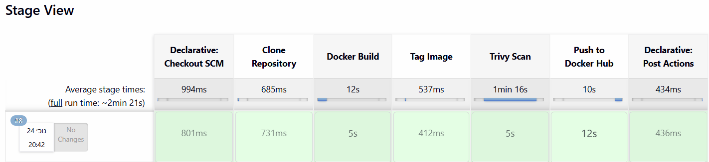

# Hello World: Flask on Kubernetes with a Jenkins CI pipeline

## Project overview

A minimal Flask application that returns **Hello World**, packaged in a Docker image and deployed to Kubernetes (k3s).

1. **Jenkins** clones the repo, builds the Docker image, tags it, scans it with Trivy and pushes it to Docker Hub.
2. **Kubernetes** runs the image with 2 replicas, exposed through a NodePort service and reachable from a browser.

### Repository layout

```
.
├── app/                 # Flask application
│   ├── app.py
│   └── requirements.txt
├── Dockerfile
├── Jenkinsfile
├── k8s/
│   ├── deployment.yaml  # 2 replicas
│   └── service.yaml     # NodePort 30080
├── docs/screenshots/    # Jenkins screenshot
└── README.md
```

## Prerequisites

Install the following:

| Tool | Purpose |
|------|---------|
| Docker | Build and push images |
| Jenkins (VM or container) | CI pipeline |
| k3s (or equivalent) | Kubernetes cluster |
| git | Source control |
| Trivy (binary or container) | Image vulnerability scan used by the pipeline |

> The Jenkins agent needs `docker` and `trivy` available. If Jenkins runs in a container, mount the Docker socket and install the Docker CLI and Trivy inside it (or build a custom Jenkins image).

## Deployment instructions

### 1. Run locally

```bash
cd app
python3 -m venv .venv && . .venv/bin/activate
pip install -r requirements.txt
python app.py            # http://localhost:5000
```

### 2. Build and push the image manually

```bash
docker build -t <dockerhub-user>/hello-world:v1 .
docker login
docker push <dockerhub-user>/hello-world:v1
```

### 3. Deploy to Kubernetes

```bash
kubectl apply -f k8s/
kubectl get pods,svc
```

Open `http://<node-ip>:30080` in a browser to see **Hello World**.

### 4. Jenkins pipeline

1. In Jenkins install the plugins: **Pipeline**, **Git**, **Credentials Binding**.
2. Add a credential with ID `dockerhub` (*Username with password*: Docker Hub user + access token).
3. Create a **Pipeline** job, choose *Pipeline script from SCM*, Git, your repo URL, branch `main`, script path `Jenkinsfile`.
4. Click **Build Now**.

Pipeline stages: **Clone Repository → Docker Build → Tag Image → Trivy Scan → Push to Docker Hub**.

The pipeline pushes `<dockerhub-user>/hello-world:v<BUILD_NUMBER>` and `:latest`. Make sure the tag used in `k8s/deployment.yaml` exists on Docker Hub (for example the `v1` pushed manually in step 2).

### Jenkins screenshot



## Troubleshooting

| Symptom | Likely cause | Fix |
|---------|--------------|-----|
| `docker: command not found` or `permission denied` on `/var/run/docker.sock` | Jenkins cannot reach Docker | Install the Docker CLI on the agent, mount the socket if Jenkins runs in a container, add the `jenkins` user to the `docker` group |
| *Trivy Scan* stage fails | Trivy found a CRITICAL vulnerability, or `trivy` is not installed | Check `trivy --version` on the agent; read the report and upgrade the base image or the packages in `app/requirements.txt` |
| *Push to Docker Hub* fails with `unauthorized` | Wrong credentials ID or expired token | Make sure a credential with ID `dockerhub` exists and holds a valid access token |
| Pods are in `ImagePullBackOff` | The tag does not exist on Docker Hub, or the repository name is wrong | `docker pull <dockerhub-user>/hello-world:<tag>` to verify and push the missing tag |
| The page does not open in the browser | NodePort blocked or wrong node IP | `kubectl get svc hello-world`, check the firewall for port 30080 |
